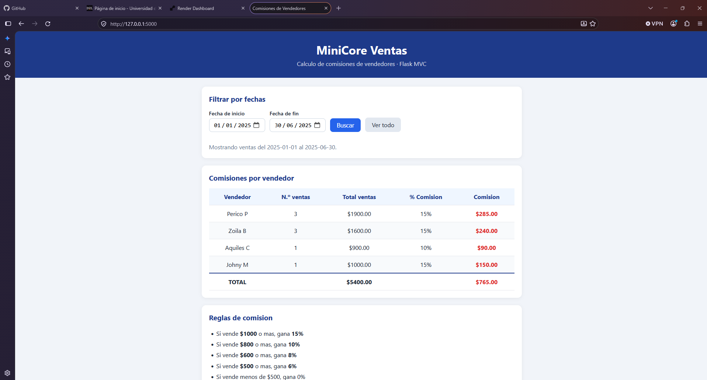

<h1 align="center">MiniCore Ventas</h1>

<p align="center">
  Aplicación web MVC con Flask que calcula las comisiones de cada vendedor según sus ventas en un rango de fechas.
</p>

<p align="center">
  
  
  
  
  
  
</p>

<p align="center">
  
</p>

---

## Índice

- [Descripción del proyecto](#descripción-del-proyecto)
- [Estado del proyecto](#estado-del-proyecto)
- [Funcionalidades](#funcionalidades)
- [Demostración](#demostración)
- [Acceso al proyecto](#acceso-al-proyecto)
- [Cómo ejecutar el proyecto](#cómo-ejecutar-el-proyecto)
- [Arquitectura MVC](#arquitectura-mvc)
- [Tecnologías utilizadas](#tecnologías-utilizadas)
- [Personas desarrolladoras](#personas-desarrolladoras)
- [Licencia](#licencia)

---

## Descripción del proyecto

**MiniCore Ventas** es un *mini core* desarrollado para la asignatura **Ingeniería Web (ISWZ3101) de la UDLA**. Su objetivo es demostrar el patrón **Modelo–Vista–Controlador (MVC)** con el framework **Flask**.

El sistema guarda vendedores, ventas y reglas de comisión. El usuario elige un rango de fechas y la aplicación suma las ventas de cada vendedor en ese periodo, aplica la regla de comisión que le corresponde y muestra el resultado en una tabla.

| Si el vendedor vende... | Gana de comisión |
| --- | --- |
| $1000 o más | 15 % |
| $800 o más | 10 % |
| $600 o más | 8 % |
| $500 o más | 6 % |
| Menos de $500 | 0 % |

## Estado del proyecto

:white_check_mark: **Terminado y publicado.**

## Funcionalidades

- :calendar: **Filtro por fechas:** muestra solo las ventas entre una fecha de inicio y una de fin.
- :heavy_dollar_sign: **Cálculo automático de comisiones:** aplica la regla más alta que alcanza el total vendido.
- :bar_chart: **Resumen por vendedor:** número de ventas, total vendido, porcentaje y comisión, con totales generales.
- :warning: **Validación de fechas:** JavaScript avisa en el navegador y Flask vuelve a revisar en el servidor si la fecha de fin es menor que la de inicio.
- :iphone: **Diseño responsive:** se adapta a computadora y celular con Flexbox y media queries.
- :seedling: **Datos de ejemplo automáticos:** al iniciar, la aplicación crea la base de datos desde `data.sql`.

## Demostración

- :globe_with_meridians: **Aplicación en línea:** https://TU-APP.onrender.com
- :movie_camera: **Video explicativo:** https://youtu.be/TU-VIDEO

Ejemplo con el rango **01/06/2025 – 30/06/2025**:

| Vendedor | Total ventas | % | Comisión |
| --- | --- | --- | --- |
| Perico P | $1500.00 | 15 % | $225.00 |
| Zoila B | $1000.00 | 15 % | $150.00 |
| Aquiles C | $900.00 | 10 % | $90.00 |
| Johny M | $1000.00 | 15 % | $150.00 |
| **Total** | **$4400.00** | | **$615.00** |

> La versión en línea usa el plan gratuito de Render: si nadie la visita en 15 minutos se suspende y la primera carga tarda cerca de un minuto.

## Acceso al proyecto

Puedes ver la aplicación en línea en el enlace de la sección [Demostración](#demostración) o descargar el código:

1. Presiona el botón verde **Code** de este repositorio.
2. Elige **Download ZIP** y descomprímelo.

O, si tienes Git instalado:

```bash
git clone https://github.com/TU-USUARIO/minicore-ventas.git
cd minicore-ventas
```

## Cómo ejecutar el proyecto

**Requisitos:** Python 3.10 o superior.

```bash
# 1. Instalar las dependencias
python -m pip install -r requirements.txt

# 2. Iniciar la aplicación
python app.py
```

Abre **http://127.0.0.1:5000** en tu navegador. Para detenerla, presiona `Ctrl + C` en la terminal.

**Despliegue en Render (gratis):**

| Campo | Valor |
| --- | --- |
| Language | Python 3 |
| Build Command | `pip install -r requirements.txt` |
| Start Command | `gunicorn app:app` |
| Instance Type | Free |

## Arquitectura MVC

```
Navegador ──(1) fechas──▶ Controlador ──(2) consulta──▶ Modelo
    ▲                         │      ◀──(3) filas────────┘
    │                    (4) resultados
    │                         ▼
    └──(5) página HTML──── Vista
```

```
minicore-ventas/
├── app.py                         # Arranque: crea la app, la base de datos y registra el controlador
├── data.sql                       # Tablas y datos de ejemplo
├── requirements.txt               # Dependencias
├── controllers/
│   └── venta_controller.py        # CONTROLADOR: recibe las fechas y calcula las comisiones
├── models/
│   ├── vendedor.py                # MODELO: tabla vendedores
│   ├── venta.py                   # MODELO: tabla ventas
│   └── regla.py                   # MODELO: tabla reglas
├── templates/
│   ├── base.html                  # VISTA: plantilla general
│   └── index.html                 # VISTA: formulario, tabla y validación JS
├── static/css/style.css           # VISTA: estilos responsive
├── utils/database.py              # Conexión SQLAlchemy
└── docs/captura.png               # Imagen de este README
```

| Capa | Archivos | Responsabilidad |
| --- | --- | --- |
| Modelo | `models/`, `data.sql`, `utils/database.py` | Define y guarda vendedores, ventas y reglas |
| Vista | `templates/`, `static/css/` | Muestra el formulario y la tabla de resultados |
| Controlador | `controllers/venta_controller.py` | Recibe la petición, consulta el modelo y calcula |

## Tecnologías utilizadas

- [Python 3](https://www.python.org/)
- [Flask](https://flask.palletsprojects.com/) – framework web
- [Flask-SQLAlchemy](https://flask-sqlalchemy.readthedocs.io/) – ORM
- [SQLite](https://www.sqlite.org/) – base de datos
- HTML5 + [Jinja](https://jinja.palletsprojects.com/) – plantillas
- CSS3 (Flexbox y media queries)
- JavaScript (validación en el navegador)
- [Gunicorn](https://gunicorn.org/) – servidor de producción
- [GitHub](https://github.com/) y [Render](https://render.com/) – repositorio y despliegue

## Personas desarrolladoras

| [<br><sub>TU NOMBRE</sub>](https://github.com/TU-USUARIO) |
| :---: |

Proyecto basado en la idea de [MiniCore_Ventas](https://github.com/JimmyAlbarrac1n/MiniCore_Ventas) de Jimmy Albarracín.

## Licencia

Este proyecto está bajo la licencia **MIT**: puedes usarlo, modificarlo y compartirlo citando a su autor.